# FoundationPose encoder diagnostics

Completed 2026-10-28T15:58:05-04:00. Scope: frozen CNN encoders in the installed FoundationPose refinement and ranking networks.

## Findings you can present

- The shared encoders load correctly and use RGB plus XYZ, with 684,480 shared-CNN parameters each.
- The largest measured final-layer spatial change was zero_xyz for refinement (0.3442) and joint_shift_5 for ranking (0.4080).
- Under identical clean inputs, cross-network linear CKA is 0.924 for the shared CNN and 0.816 for the artificial self-pair fusion CNN. This describes representation geometry, not task accuracy.
- On the object-specific orientation readout, final pretrained pooled features give 42.67° (refinement) and 43.14° (ranking) mean symmetry-aware error, versus 81.92° for the constant baseline. Random-feature controls give 51.17° and 48.34°. These are GT-conditioned diagnostic probes, not deployed pose errors.
- For a joint 5-pixel shift, spatial versus pooled cosine distances are 0.3292 versus 0.0008 in refinement and 0.4080 versus 0.0008 in ranking. Pooling can hide spatial changes relevant to alignment.

The contribution is an empirical encoder audit and controlled sensitivity study. It is not a new pose-estimation method, a retrained model, or an official benchmark result. The encoder measurements finished substantially faster than the original 8–12-hour estimate; no time was padded and no twelve-hour run is claimed.

## What the encoder does

The architecture uses the same CNN weights for the rendered and observed branch **within** each network. Their features are concatenated and processed by a second CNN. Refinement and ranking are separate networks with separate checkpoint weights. The [FoundationPose paper](https://openaccess.thecvf.com/content/CVPR2024/papers/Wen_FoundationPose_Unified_6D_Pose_Estimation_and_Tracking_of_Novel_Objects_CVPR_2024_paper.pdf) places these CNNs before the pose-update and candidate-comparison modules. All architecture counts and shapes below were checked directly against installed source and checkpoints.

Input: 6 × 160 × 160, consisting of RGB in [0,1] and normalized XYZ. The shared CNN produces 64 × 80 × 80, then 128 × 40 × 40, then two residual-block outputs of 128 × 40 × 40. Pair concatenation produces 256 × 40 × 40. The fusion CNN has two 256-channel residual blocks, a stride-2 convolution to 512 × 20 × 20, and two 512-channel residual blocks. The shared CNN's theoretical maximum receptive fields are 7, 11, 27, and 43 input pixels; the final fusion block reaches 147 pixels. These are architectural receptive fields, not attention or measured pixel importance.

| Network | Shared_CNN_parameters | Fusion_CNN_parameters | Full_network_parameters | Crop_ratio |
| --- | --- | --- | --- | --- |
| refine | 684,480 | 12,986,880 | 16,830,406 | 1.2 |
| score | 684,480 | 12,986,880 | 15,773,121 | 1.1 |

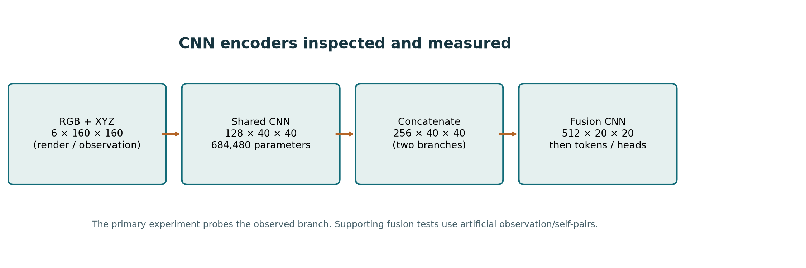

This resolves a practical source of confusion: the model constructors default to four channels, but the installed pretrained configurations explicitly request six. Using constructor defaults would not reproduce these checkpoints.

## Design and coverage

- Primary: 520 unique frames, 40 per object across 13 LINEMOD objects; 260 development and 260 held-out diagnostic frames. Both pretrained networks and one fixed random-weight control each. 23 named conditions, expanded to 39 condition/seed combinations by using three seeds for stochastic disturbances.
- Primary coverage: 2,080 frame/variant records, 81,120 perturbed-or-clean encoder inputs, and 324,480 stage/condition/seed records. These are repeated measurements of 520 frames, not independent data points.
- Supporting controls: 130 development frames (10 per object), 2 networks, 1 pretrained variant plus 3 initialization seeds for each of 3 controls. 2,600 frame/variant records; 31,200 encoder inputs; 280,800 stage/condition records across 4 shared and 5 fusion blocks.
- Control variants: random convolution plus reset BatchNorm; random convolution plus trained BatchNorm; trained convolution plus reset BatchNorm. The supporting study gives both networks identical crops and validity thresholds.
- Exact key coverage, stage coverage, finite values, and clean identity comparisons passed. CPU normalization agrees with the original normalization functions within 1.2e-07. Random networks under common inputs agreed across both architectures.

Measurements used torch inference/eval mode on CPU. Full checkpoints were loaded strictly. Original class and helper-function bodies were extracted using AST to bypass GPU-specific imports; CNN definitions and forward logic were not rewritten. Source, configuration, checkpoint, dataset-image, and annotation hashes are recorded in the primary manifest.

## Input construction and interventions

Crop center is projected GT translation of the bounding-box-centered CAD mesh: t_centered = t_original + R × center_CAD. Size is derived from the metadata CAD diameter and crop ratio. Native ratios are 1.2 for refinement and 1.1 for ranking. RGB uses bilinear perspective warping and XYZ uses nearest-neighbor warping, matching the inspected crop interpolation settings. XYZ is camera-space backprojection, minus centered translation, divided by CAD radius. Invalid depth and individual XYZ components outside [-2,2] are zeroed following the installed normalization code. The source refinement path uses 0.001 m depth validity; ranking uses 0.1 m.

These diagnostics use raw dataset depth, metadata diameter, per-image intrinsics, and GT alignment. Production registration additionally filters depth and estimates diameter from sampled vertices. The study therefore tests controlled inputs to the encoder, not exact production replay. Native cross-network contrasts combine learned weights and preprocessing; within-network trained/random comparisons are paired on identical tensors. The common-input supporting experiment removes this preprocessing difference.

Brightness factors 0.5 and 1.5; Gaussian blur sigma 1 and 3 crop pixels; RGB Gaussian noise sigma 0.02 and 0.1 on [0,1]; Gaussian depth noise sigma 1, 5, and 10 mm at valid crop pixels; independent depth dropout 10%, 30%, 50%; RGB/XYZ removal; +2/+5 horizontal crop-pixel shifts of RGB, XYZ, or both; central square masks of approximately 10%/30% crop area. Shift fill and modality removal use zero in normalized input space. Occlusion is an artificial missing-data intervention, not physically rendered occlusion. These sensor-noise settings are not calibrated to a physical camera. Different perturbation magnitudes are not equal-severity measurements.

## Metrics and uncertainty

For clean activation F and disturbed activation G, spatial cosine distance is 1 − dot(vec(F),vec(G))/(norm(F) norm(G)). Relative L2 drift is norm(G−F)/norm(F). Pooled cosine distance computes cosine after global average pooling. Also recorded: activation zero fraction and RMS. A smaller drift means a more stable representation for this intervention; a constant, uninformative representation can also have low drift. Spatial shift sensitivity can reflect useful localization rather than a defect.

Seeds are averaged within each frame before aggregation. Per-object means are macro-averaged. Intervals use 2,000 paired object-stratified frame bootstrap samples with fixed seed; uncertainty is conditional on these objects, checkpoint weights, and selected frames. Frames from the same object sequence may be temporally correlated, so these intervals can be optimistic and are not unseen-object generalization intervals. The primary held-out partition was already used in previous diagnostics; it is not pristine test data. No model or condition was selected to optimize these held-out numbers. No multiple-comparison significance claims are made.

## Primary held-out results

Final shared-CNN spatial cosine distance, mean and 95% bootstrap interval. Distances are dimensionless and are **not** pose-error percentages. Complete results for all conditions, layers, splits, and objects are in the CSV tables.

| Condition | Refinement, mean [95% CI] | Ranking, mean [95% CI] |
| --- | --- | --- |
| brightness_0.5 | 0.0131 [0.0129, 0.0132] | 0.0136 [0.0136, 0.0137] |
| blur_3 | 0.0797 [0.0785, 0.0808] | 0.1069 [0.1053, 0.1086] |
| zero_rgb | 0.2296 [0.2276, 0.2316] | 0.3044 [0.3018, 0.3070] |
| zero_xyz | 0.3442 [0.3423, 0.3460] | 0.2740 [0.2714, 0.2765] |
| rgb_shift_5 | 0.2366 [0.2339, 0.2394] | 0.3492 [0.3450, 0.3532] |
| xyz_shift_5 | 0.1114 [0.1099, 0.1130] | 0.0702 [0.0688, 0.0716] |
| joint_shift_5 | 0.3292 [0.3263, 0.3319] | 0.4080 [0.4042, 0.4117] |
| rgb_noise_0.1 | 0.0416 [0.0407, 0.0425] | 0.0580 [0.0565, 0.0595] |
| depth_noise_5 | 0.0055 [0.0050, 0.0060] | 0.0024 [0.0021, 0.0028] |
| depth_dropout_0.3 | 0.0234 [0.0232, 0.0236] | 0.0187 [0.0185, 0.0190] |
| occlusion_0.3 | 0.1971 [0.1953, 0.1988] | 0.2308 [0.2292, 0.2323] |

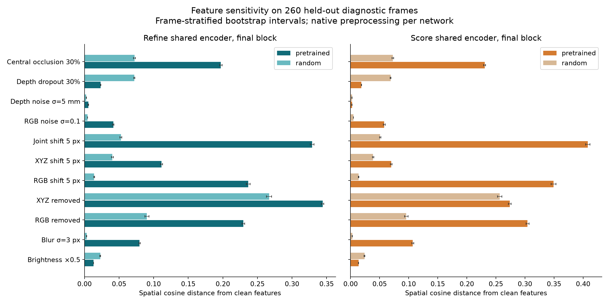

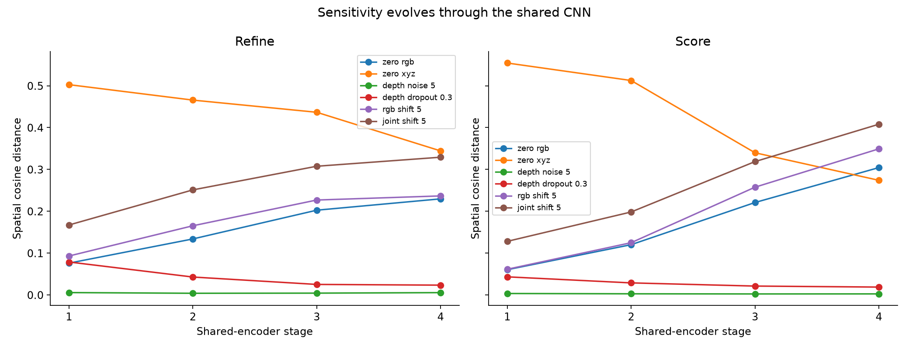

### Spatial versus pooled features

| kind | condition | spatial | pooled |
| --- | --- | --- | --- |
| refine | joint_shift_5 | 0.3292 | 0.0008 |
| refine | depth_noise_5 | 0.0055 | 0.0002 |
| refine | zero_xyz | 0.3442 | 0.1890 |
| score | joint_shift_5 | 0.4080 | 0.0008 |
| score | depth_noise_5 | 0.0024 | 0.0001 |
| score | zero_xyz | 0.2740 | 0.1924 |

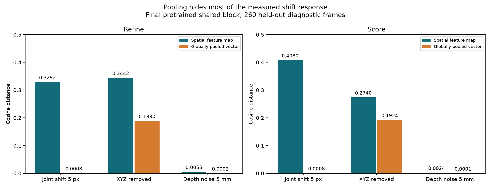

Pooling discards spatial arrangement and may conceal changes that matter to pose estimation. That is why both metrics are retained. Do not replace the full pose-conditioned comparison with a pooled feature cosine based on these diagnostics alone.

## Learned weights and normalization controls

The primary random baseline changes both learned convolution weights and BatchNorm parameters/statistics. This is a useful architecture control but cannot isolate their causes. The supporting common-input study separates those components. Values below are final shared-block spatial distances, averaged across frames and control initializations.

| kind | condition | pretrained | random | random_conv_trained_bn | trained_conv_reset_bn |
| --- | --- | --- | --- | --- | --- |
| refine | depth_dropout_0.3 | 0.0233 | 0.0719 | 0.0001 | 0.0061 |
| refine | depth_noise_5 | 0.0051 | 0.0025 | -0.0 | 0.0014 |
| refine | zero_rgb | 0.2303 | 0.0626 | 0.0001 | 0.0014 |
| refine | zero_xyz | 0.3442 | 0.2529 | 0.0003 | 0.6886 |
| score | depth_dropout_0.3 | 0.0197 | 0.0719 | 0.0 | 0.0011 |
| score | depth_noise_5 | 0.0021 | 0.0025 | -0.0 | 0.0007 |
| score | zero_rgb | 0.3028 | 0.0626 | 0.0 | 0.0028 |
| score | zero_xyz | 0.2797 | 0.2529 | 0.0002 | 0.2943 |

Clean activation scale and pooled-feature spread help interpret these distances. The centered variation fraction is ||X − mean_frame(X)||_F / ||X||_F for pooled clean features across frames; control seeds are summarized by their mean. Values near zero indicate that sample-to-sample variation is small relative to the shared activation offset. This statistic is descriptive, not a task-performance score.

| kind | variant | rms | pooled_rms | centered_variation_fraction | effective_rank |
| --- | --- | --- | --- | --- | --- |
| refine | pretrained | 1.23468 | 0.71474 | 0.19319 | 7.89843 |
| refine | random | 0.11015 | 0.08942 | 0.1587 | 4.21867 |
| refine | random_conv_trained_bn | 1.6608 | 1.65997 | 0.00435 | 3.14328 |
| refine | trained_conv_reset_bn | 808.80098 | 600.03925 | 0.25961 | 1.79374 |
| score | pretrained | 1.36958 | 0.77832 | 0.2008 | 7.76005 |
| score | random | 0.11015 | 0.08942 | 0.1587 | 4.21867 |
| score | random_conv_trained_bn | 1.57805 | 1.57751 | 0.0036 | 3.65064 |
| score | trained_conv_reset_bn | 7300.64507 | 5551.85986 | 0.28588 | 1.25763 |

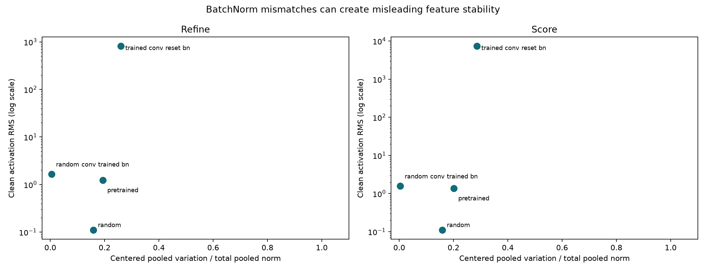

For example, mismatching random convolution weights with trained BatchNorm can yield very small disturbance drift alongside little relative variation across inputs. Conversely, resetting trained normalization can inflate activation scale. Neither is evidence of a better encoder. This is a concrete reason to inspect feature spread and controls alongside stability. The trained networks themselves retain their original normalization throughout the primary study.

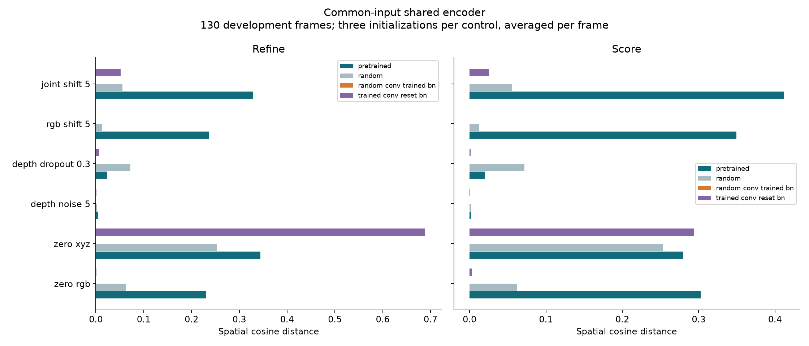

Hybrids combine parameters that were never trained together. They diagnose sensitivity to parameter groups; high drift or unusual activation scale in a hybrid is not evidence that the deployed encoder is broken. First-convolution RGB/XYZ weight norms are in weight_audit.csv; input scale and later layers prevent interpreting those norms directly as modality importance.

## Pair-fusion encoder

The fusion diagnostic fixes A to a clean observation and perturbs B. Its baseline is an artificial observation/observation self-pair. It measures how the actual fusion CNN propagates a disturbance, without needing a GPU renderer. It does not test real rendered/observed alignment. The final fusion features have 512 × 20 × 20 elements before positional embedding and task modules.

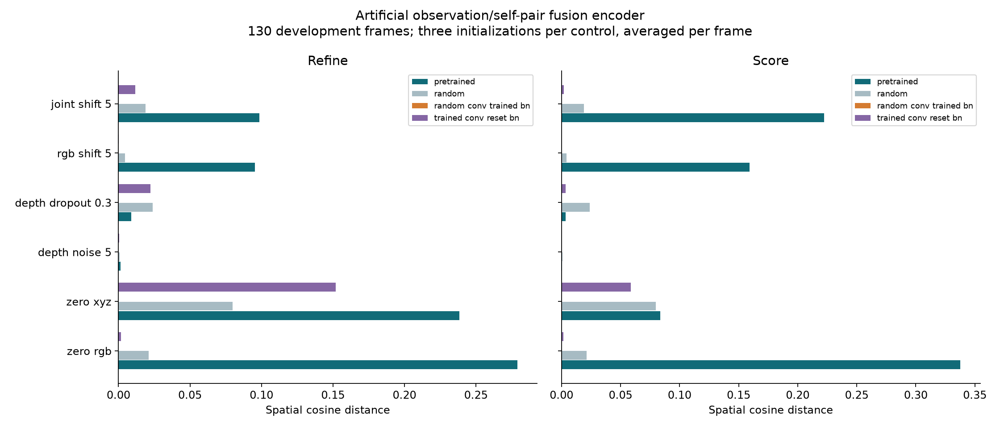

## A fixed feature-map illustration

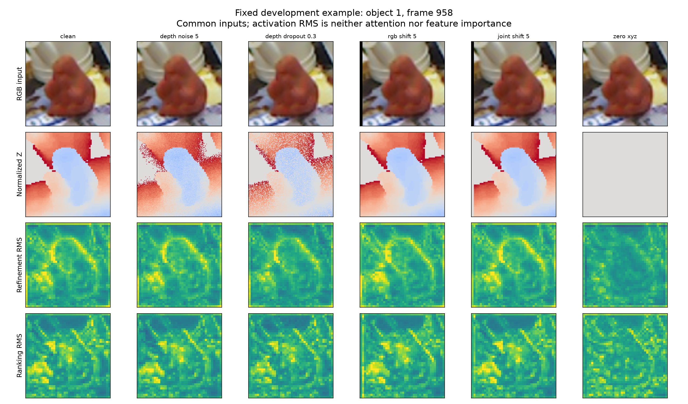

The first pre-existing development row, object 1/frame 958, was used without selecting for a favorable outcome. Per-location RMS across feature channels is shown with a fixed scale within each network. These maps visualize activation magnitude, not attention or causal importance. The two networks receive identical diagnostic inputs in this illustration.

## Representation geometry and object retrieval

Linear CKA on pooled clean features compares centered relationships between frames. Under common inputs, refinement-versus-ranking CKA is 0.9237 at the last shared block and 0.8161 at the final artificial self-pair fusion block. CKA's use for representation comparison follows [Kornblith et al., ICML 2019](https://proceedings.mlr.press/v97/kornblith19a.html); high CKA does not mean identical weights or identical task behavior. Effective ranks and all layer comparisons are included in the CSVs.

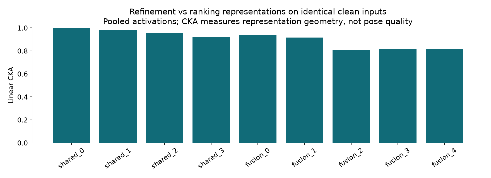

Nearest-neighbor object retrieval uses 260 development gallery frames and 260 held-out queries, cosine similarity of pooled features, no trained classifier, and object-macro accuracy. Clean final-block values:

| variant | object_retrieval_accuracy |
| --- | --- |
| refine_pretrained | 77.31% |
| score_pretrained | 77.31% |
| refine_random | 64.23% |
| score_random | 68.46% |

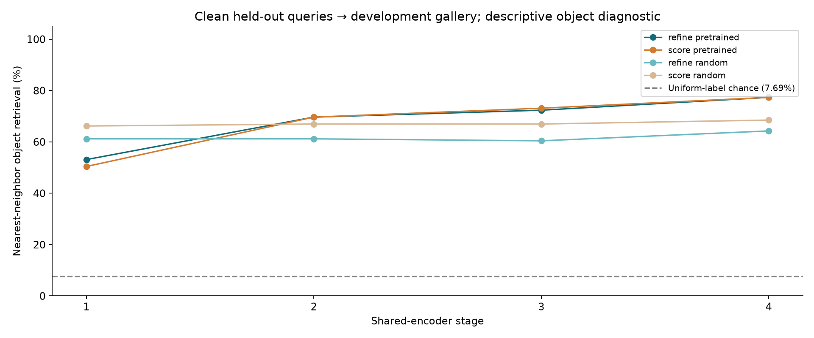

This is object identity among the same 13 objects in the same dataset, not pose estimation or recognition of unseen objects. Background, lighting, sequence similarity, and crop scale can support retrieval. Random features may also retain useful image similarity. The random controls and effective-rank tables are essential to interpretation. There is no independently established chance distribution; 1/13 is merely a uniform-label reference.

## Frozen-feature orientation probe

To test more than stability or object identity, an object-specific ridge readout predicts nine orientation-matrix entries from clean pooled features. Encoder weights remain frozen. Each object has 20 development training frames and 20 held-out frames. Five-fold development-only selection chooses alpha from [0.01, 0.1, 1, 10, 100, 1000]; standardization is fitted separately inside every training fold. Predicted matrices are projected to SO(3). Three label-permutation controls repeat the same selection procedure. Their errors are averaged per held-out frame.

The constant baseline is the projected development mean rotation for each object. Raw error is geodesic rotation angle; symmetry-aware error minimizes over identity and annotated discrete rotation symmetries. This orientation-only metric ignores symmetry translations and is not ADD/MSSD or official BOP evaluation. Complete per-stage/per-object results, selected alphas, per-frame errors, and paired bootstrap changes are in orientation_probe_*.csv. Final shared-block and constant-baseline values, in degrees:

| variant | stage | raw_deg | symmetry_deg |
| --- | --- | --- | --- |
| constant | -1 | 90.59 | 81.92 |
| refine_pretrained | 3 | 47.78 | 42.67 |
| refine_pretrained_shuffled | 3 | 90.61 | 82.91 |
| refine_random | 3 | 54.10 | 51.17 |
| refine_random_shuffled | 3 | 89.20 | 82.25 |
| score_pretrained | 3 | 49.99 | 43.14 |
| score_pretrained_shuffled | 3 | 89.61 | 81.40 |
| score_random | 3 | 53.80 | 48.34 |
| score_random_shuffled | 3 | 88.30 | 81.60 |

The advantage is not uniform: the pretrained final block beats its random-feature control on 9/13 objects for refinement and 8/13 for ranking. At the first shared stage, the trained pooled-feature probe is worse than the random control on the object-macro average; the pretrained advantage appears later. This is conditional on this readout and input construction and does not establish superiority of every trained layer. Final per-object symmetry-aware errors:

| obj_id | refine_pretrained | refine_random | score_pretrained | score_random |
| --- | --- | --- | --- | --- |
| 1 | 37.84 | 55.36 | 31.7 | 55.97 |
| 2 | 32.2 | 21.67 | 51.98 | 25.61 |
| 4 | 32.84 | 35.1 | 41.07 | 33.05 |
| 5 | 49.4 | 68.25 | 54.42 | 67.02 |
| 6 | 26.85 | 40.66 | 23.23 | 45.52 |
| 8 | 37.11 | 66.24 | 41.57 | 45.86 |
| 9 | 57.48 | 75.92 | 43.07 | 64.62 |
| 10 | 45.94 | 41.56 | 47.11 | 45.96 |
| 11 | 43.7 | 41.51 | 40.94 | 41.29 |
| 12 | 42.55 | 47.63 | 37.75 | 49.31 |
| 13 | 67.69 | 70.91 | 70.1 | 56.01 |
| 14 | 37.39 | 34.92 | 30.47 | 29.98 |
| 15 | 43.77 | 65.42 | 47.37 | 68.25 |

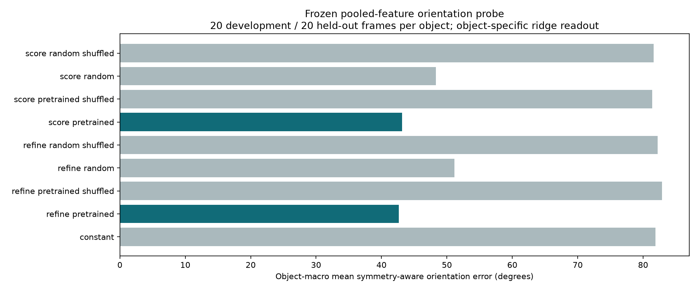

This measures decodability in GT-conditioned crops with known object identity, not blind pose accuracy or unseen-object generalization. GT affects centering, crop scale, and normalization; the rotated CAD center also influences crop alignment. Pooling discards information used by the actual spatial pair-comparison network. The first pooled stage has 64 channels and later shared stages have 128, so cross-stage comparisons also change readout dimension. Probe bootstrap intervals condition on fitted readouts and development frames; they do not resample and refit training sets. Primary random-feature probes use one initialization; the three-initialization supporting controls address feature sensitivity, not orientation-probe initialization uncertainty. Poor probe performance would not establish that the full encoder lacks pose information, and good performance would not validate the installed pose heads.

## What this establishes

The installed encoders can be loaded and probed reproducibly on CPU. They encode both RGB appearance and centered XYZ geometry, and their feature sensitivity can be quantified across layer depth and interventions. The study provides paired comparisons, normalization controls, and measured representation comparisons to support discussion with your professor.

It does not establish downstream ADD(-S), MSSD/MSPD, actual candidate ordering, rendered/observed matching, robustness to real sensor failure, training-set novelty, causal feature importance, or a better encoder architecture. The study does not modify pretrained weights or claim to improve the prior point-filter results.

## Recommended next experiment

Once CUDA is available, save real rendered/observed tensors at fixed candidate poses, validate exact production preprocessing, and repeat the encoder probes on those tensors. Start from a predefined grid of translation and symmetry-aware rotation perturbations around GT poses. Measure encoder drift alongside change in pose error after refinement and within-set ranking quality. Keep the rendered inputs, pose-conditioned crops, and candidate sets fixed for each controlled input intervention. Then test whether the feature diagnostics predict downstream failure on a separately selected object/sequence set. A correlation would still not show that a particular feature caused the failure.

## Relation to the earlier filtering study

The prior point-filter study changes initialization masks while retaining full-image RGB/depth inputs. This study applies interventions directly to normalized encoder inputs with fixed GT-aligned crops. Consequently, a five-pixel input shift here is a different experiment from a five-pixel initialization-mask shift. No cross-study numerical equivalence is claimed.

## Research context

The [FoundationPose paper](https://openaccess.thecvf.com/content/CVPR2024/papers/Wen_FoundationPose_Unified_6D_Pose_Estimation_and_Tracking_of_Novel_Objects_CVPR_2024_paper.pdf) motivates learned rendered/observed comparison and separate refinement/ranking modules. [Kornblith et al.](https://proceedings.mlr.press/v97/kornblith19a.html) motivate representation comparison with CKA. [Hendrycks and Dietterich](https://arxiv.org/abs/1903.12261) motivate testing several common corruption families; the current RGB-XYZ interventions are a custom diagnostic suite, not ImageNet-C. [Adebayo et al.](https://proceedings.neurips.cc/paper/2018/hash/294a8ed24b1ad22ec2e7efea049b8737-Abstract.html) show why visually appealing explanations need model-dependent sanity checks; our random and normalization controls follow that general caution, without claiming to reproduce their saliency experiments.

## Execution and reproduction

Primary measurement wall time: 12.77 minutes. Supporting measurement wall time: 19.02 minutes for its completion invocation, which reused 260 already completed supporting pilot frame/variant records; pilot time is separately logged. Runs overlapped, so their times must not be added to claim elapsed study duration. No twelve-hour experiment is claimed. Analysis and artifact preparation are separate from encoder measurement time.

Use /home/Sahil/miniforge3/envs/foundationpose/bin/python from this directory:

```bash
python validate.py
python audit.py
python study.py
python secondary.py
python probe.py
python analyze.py
python illustrate.py
python build_report.py
```

Existing matching checkpoints resume; source/configuration mismatches require a fresh output directory. Primary and secondary processes use independent advisory locks. Numerical validation must pass before interpreting results. Results reflect these installed checkpoints and Python/package versions. GPU validation is unperformed because CUDA was unavailable, not silently replaced with a benchmark claim.

Files: results/ and secondary_results/ contain checkpointed measurements and manifests; analysis/ contains complete tables and figures; validation.json, analysis_validation.json, and encoder_audit.json contain verification evidence. PRESENTATION.pdf and PRESENTATION.pptx contain the talk; SPEAKER_NOTES.md includes narration. PRESENTATION_QA.md covers likely questions. The PowerPoint file uses rendered slide images plus speaker notes, preserving appearance; the source text lives in build_report.py.
