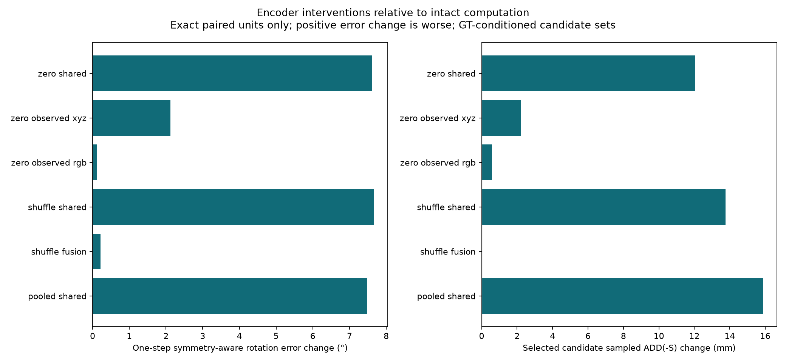

# GPU encoder investigation — Live partial report

Updated 2026-10-29T04:56:40-04:00. Process state: **running**.

Started: 2026-10-28T17:06:03.876991-04:00. Scheduled deadline: 2026-10-29T05:06:03.876991-04:00.
Completed units: 765,859; recorded failed units: 0. Distinct frames: 15,800; objects represented: 13; real pose candidates evaluated per unit: 37. Elapsed wall time at status update: 11.840 hours.

This is the extension to the earlier CPU-only report. CUDA is accessible outside the sandbox; the earlier claim of a driver problem was incorrect. These new experiments use the installed renderer, source depth filtering, real rendered/observed inputs, frozen pretrained CNNs, and the actual refinement/ranking heads.

## What was measured

The queue changes input disturbances and then intervenes on observed RGB, XYZ, shared-CNN spatial structure, or fusion-CNN spatial structure. Replacing a map by its spatial mean preserves channel means but destroys its layout. The same initial 37 candidates and candidate ordering are retained across matched units. One-step refinement and ranking on the original candidate set are separate endpoints. Ranking includes a GT candidate and does not measure blind global registration.

Every unit has per-candidate known initial errors, refined errors, scores, feature distances, and poses in units/*.json. Compact per-unit summaries are transactionally stored in summary.sqlite. No pretrained weights are changed. Feature interventions are deliberately out of distribution; task degradation establishes sensitivity to those interventions, not a validated encoder replacement.

## Coverage and descriptive means

The tables reflect completed units, not assumed completion of the full oversized queue. They must not be compared as though every group covered identical frames. Summary means first average repeated units within a frame and then macro-average represented objects. Missing groups are not silently treated as completed successes. See analysis/coverage.csv for exact object/condition/intervention coverage. Ranking selection errors average over all exactly tied maximum-logit candidates, rather than letting the first GT candidate win a constant-score tie. Raw argmax indices remain in the raw records. Constant-score Spearman correlations are undefined, not perfect: ranking_spearman_defined reports their availability and ranking_tie_count reports degeneracy.

| condition | ablation | units | objects | refined_rotation_deg | selected_adds_mm |
| --- | --- | --- | --- | --- | --- |
| clean | intact | 21884 | 13 | 3.5317 | 3.8405 |
| clean | pooled_shared | 21884 | 13 | 10.9979 | 19.7066 |
| clean | shuffle_fusion | 21884 | 13 | 3.7478 | 3.8634 |
| clean | shuffle_shared | 21884 | 13 | 11.1886 | 17.6073 |
| clean | zero_observed_rgb | 21884 | 13 | 3.6405 | 4.4169 |
| clean | zero_observed_xyz | 21884 | 13 | 5.6472 | 6.1091 |
| clean | zero_shared | 21884 | 13 | 11.1342 | 15.8658 |
| depth_dropout30 | intact | 21881 | 13 | 3.5373 | 3.8352 |
| depth_dropout30 | pooled_shared | 21871 | 13 | 10.9923 | 19.7253 |
| depth_dropout30 | shuffle_fusion | 21871 | 13 | 3.7555 | 3.8613 |
| depth_dropout30 | shuffle_shared | 21871 | 13 | 11.1785 | 17.5746 |
| depth_dropout30 | zero_observed_rgb | 21871 | 13 | 3.6696 | 4.4304 |
| depth_dropout30 | zero_observed_xyz | 21871 | 13 | 5.6473 | 6.1114 |
| depth_dropout30 | zero_shared | 21871 | 13 | 11.1343 | 15.8654 |
| depth_noise5mm | intact | 21884 | 13 | 3.5645 | 3.8357 |
| depth_noise5mm | pooled_shared | 21884 | 13 | 10.975 | 19.764 |
| depth_noise5mm | shuffle_fusion | 21884 | 13 | 3.7864 | 3.8581 |
| depth_noise5mm | shuffle_shared | 21884 | 13 | 11.1585 | 17.5305 |
| depth_noise5mm | zero_observed_rgb | 21884 | 13 | 3.7616 | 4.4446 |
| depth_noise5mm | zero_observed_xyz | 21884 | 13 | 5.6472 | 6.1091 |
| depth_noise5mm | zero_shared | 21884 | 13 | 11.1342 | 15.8658 |
| rgb_blur3 | intact | 21884 | 13 | 3.6345 | 4.0063 |
| rgb_blur3 | pooled_shared | 21884 | 13 | 10.7683 | 19.5078 |
| rgb_blur3 | shuffle_fusion | 21884 | 13 | 3.8389 | 4.0319 |
| rgb_blur3 | shuffle_shared | 21884 | 13 | 10.8599 | 18.0784 |
| rgb_blur3 | zero_observed_rgb | 21884 | 13 | 3.6405 | 4.4169 |
| rgb_blur3 | zero_observed_xyz | 21884 | 13 | 6.2131 | 6.2382 |
| rgb_blur3 | zero_shared | 21884 | 13 | 11.1342 | 15.8658 |
| rgb_half | intact | 21884 | 13 | 3.5495 | 3.851 |
| rgb_half | pooled_shared | 21884 | 13 | 10.9102 | 19.6403 |
| rgb_half | shuffle_fusion | 21884 | 13 | 3.7517 | 3.8844 |
| rgb_half | shuffle_shared | 21884 | 13 | 11.0553 | 17.738 |
| rgb_half | zero_observed_rgb | 21884 | 13 | 3.6405 | 4.4169 |
| rgb_half | zero_observed_xyz | 21884 | 13 | 5.7004 | 6.1159 |
| rgb_half | zero_shared | 21884 | 13 | 11.1342 | 15.8658 |

## Exact paired effects

analysis/paired_encoder_interventions.csv compares each intervention with intact computation only on matching frame, condition, seed and candidate set. Different interventions can have different denominators. Positive differences mean larger errors. At final reporting, 2,000 within-object frame bootstrap resamples give conditional intervals; candidate/seed repeats are not counted as independent frames. These intervals do not model correlated sequences or retraining uncertainty, and no multiple-testing significance claim is made.

## Limitations

GT centers the local candidate neighborhood; initial errors are restricted to the declared grid. The prior 520-frame diagnostic split is reused and additional frames are from the same LM sequences. No new model selection is performed. Per-image camera intrinsics and source-generated mesh diameter are used. CAD geometry and annotations are fixed input information. Sampled ADD/ADI uses 512 deterministic CAD vertices and is not full-mesh ADD, official BOP AR, VSD, MSSD or MSPD. Rotation errors include raw and annotated discrete-symmetry-aware versions. Ranking quality is conditional on this favorable candidate set. Correlations between feature distance and pose error are descriptive; the separate feature-map interventions test the installed computation under artificial changes.

## Reproduction and next interpretation

Read ../PROTOCOL.md for the predeclared design. run_gpu.py resumes matching atomic checkpoints and refuses source mismatches; summary.sqlite supports live reporting. GPU execution requires running outside the restricted tool sandbox on this server. Source hashes are in manifest.json; object geometry hashes are in objects/*.json. Raw data are preserved in units/*.json. Live reports are partial and the final report is valid only with its explicit process state and coverage.

For Friday, present the paired effects with their frame counts, then relate them to spatial-versus-pooled feature distances. Do not present all low-drift features as robust, or these local tests as a global pose benchmark. The earlier CPU slides provide architecture and sanity-check context; this phase supplies real-pair/task evidence.
