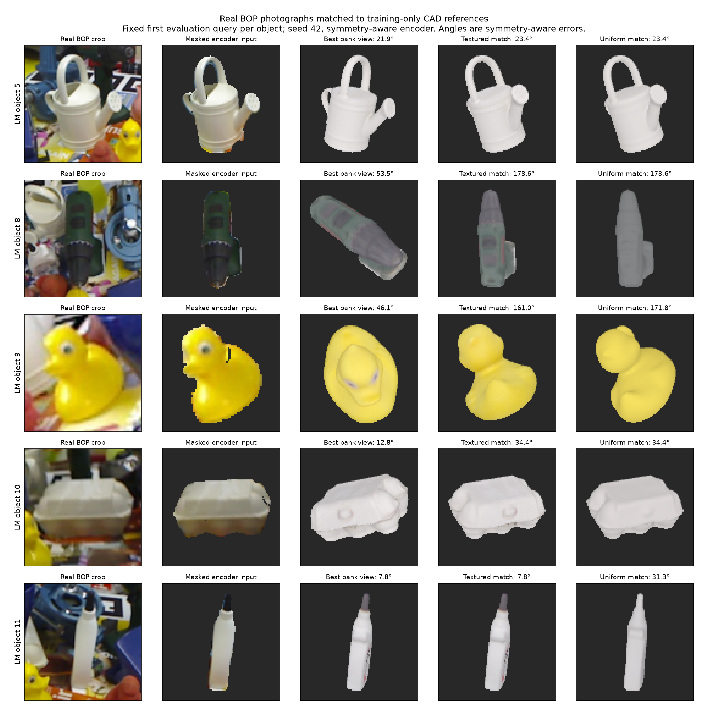
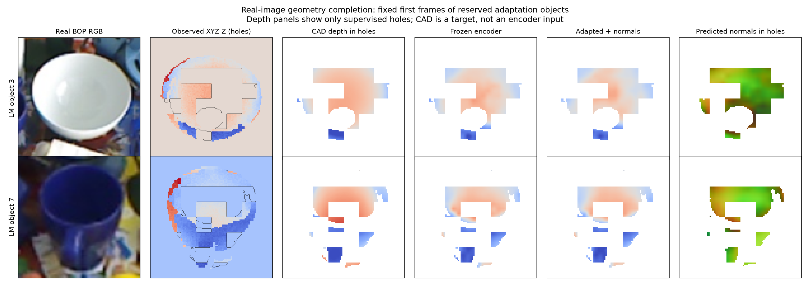
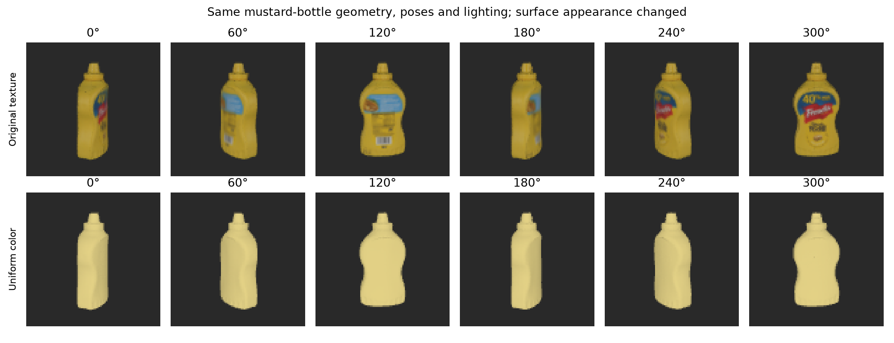

# Encoder experiments for the mentor meeting — November 11, 2026

## What the mentor’s three notes became

- **Fine-tune symmetry:** compare ordinary and symmetry-aware reference-rotation supervision, using BOP discrete symmetry annotations for the eggbox and glue bottle.
- **Add structure with a pipeline:** real RGB-D crop → hide XYZ patches → shared encoder → depth/normal decoder, with reproducible manifests, matched seeds and independent readout checks.
- **Make texture useful:** match real RGB object crops to differently oriented CAD references, then replace only reference appearance with uniform color while holding geometry fixed. This encourages and tests appearance use; it does not guarantee texture learning.

## Main findings

- Surface-normal supervision reduced reserved-object surface-direction error from **22.00° to 20.38°** (three-seed averages). The fresh-decoder comparison was **22.69° to 21.00°**, supporting a modest improvement in normal decodability in this controlled completion task.
- Depth completion did not improve consistently over the original frozen encoder. A simple nearest-observed-depth baseline was better at depth filling. Do not claim general geometric reconstruction success.
- Real-image textured-reference rotation error: pretrained **105.45°**, ordinary adaptation **104.08°**, symmetry-aware adaptation **104.86°**. These are high errors; judge adaptation relative to the baseline and bank coverage, not as deployment-ready accuracy.
- All queries in the two main experiments are real BOP photographs. CAD renders are reference views or geometry labels. The mustard illustration is separate and uses the FoundationPose demo asset.

## Geometry completion: real BOP RGB-D

Original encoder: FoundationPose refinement shared CNN, original weights untouched. Keep measured XYZ context but hide 40% of an 8×8 block grid; add 2 mm noise to retained depth. Predict missing CAD depth and surface normals. Pose and camera labels generate targets, never fill the hidden XYZ input. Context center is computed from retained observations only.

Seven training objects; development objects 10/11 select checkpoints. Objects 3/7 were excluded from the preceding adaptation run and reserved for this follow-up. Earlier evaluation objects 12–15 are exploratory. Train 1500 steps per arm/seed and 500 steps per fresh-decoder probe; three seeds, 18,000 optimizer steps. Both adapted arms use the same small feature anchor.

| Encoder/readout | Reserved depth MAE mm ↓ | Reserved normal angle deg ↓ |
|---|---:|---:|
| frozen | 11.38 | 22.00 |
| depth | 11.67 | unsupervised |
| normal | 11.49 | 20.38 |
| probe_frozen | 11.73 | 22.69 |
| probe_depth | 12.07 | 21.78 |
| probe_normal | 11.74 | 21.00 |

Observed-only nearest-fill depth baseline: **9.49 mm**. Normal metric is object-macro average of per-image median angular error. The depth-only model’s normal branch is unsupervised. Fresh probes freeze the encoder and reinitialize an identical decoder.

## Rotation and texture: real BOP RGB queries

Objects: can (5), driller (8), duck (9), eggbox (10), glue (11). Per object: 144 training, 36 development and 36 evaluation queries, with two temporal buffer blocks. The 48-reference bank comes only from training poses. No evaluation GT pose is inserted into the bank. Train ordinary and symmetry-aware encoders for 1500 steps, three seeds, 9000 optimizer steps. Report all objects, including difficult failures.

| Encoder | References | Rotation error deg ↓ | Recall ≤30° ↑ | Oracle bank error deg ↓ |
|---|---|---:|---:|---:|
| pretrained | textured | 105.45 | 27.2% | 30.61 |
| pretrained | uniform | 106.95 | 25.6% | 30.61 |
| ordinary | textured | 104.08 | 27.2% | 30.61 |
| ordinary | uniform | 104.45 | 27.8% | 30.61 |
| symmetry | textured | 104.86 | 27.4% | 30.61 |
| symmetry | uniform | 105.83 | 26.5% | 30.61 |

The oracle is the closest orientation available in the fixed bank, selected using labels only for diagnostic coverage measurement. Texture ablation keeps the real query unchanged and changes CAD-reference appearance. A gap therefore measures sensitivity to reference appearance, not label understanding alone. Rotation equivalence uses the rotational part of BOP symmetries; this is not a full-pose loss handling symmetry translations.

## Real images and predictions

The comparison images show the first evaluation query of each object, fixed before results. Background masking and crop boxes use GT visible masks. Rendered references are labeled as such.

## Additional robustness checks

Changed missingness and noise; no retraining:

No training or checkpoint selection occurred here. Original 40% missing, 2mm-noise checkpoints were evaluated under changed input corruption. Reused objects make this additional exploratory robustness evidence.

| Condition | Encoder/readout | Reserved depth mm | Reserved normal angle deg |
|---|---|---:|---:|
| lighter_holes | frozen | 10.485 | 21.07 |
| lighter_holes | normal | 10.521 | 19.53 |
| lighter_holes | probe_frozen | 10.732 | 21.52 |
| lighter_holes | probe_normal | 10.771 | 20.18 |
| lighter_holes | nearest observed depth | 8.103 | — |
| larger_holes | frozen | 13.689 | 25.93 |
| larger_holes | normal | 13.926 | 24.40 |
| larger_holes | probe_frozen | 14.178 | 26.72 |
| larger_holes | probe_normal | 14.164 | 24.83 |
| larger_holes | nearest observed depth | 12.394 | — |
| noisier_context | frozen | 11.339 | 22.18 |
| noisier_context | normal | 11.470 | 20.60 |
| noisier_context | probe_frozen | 11.720 | 22.87 |
| noisier_context | probe_normal | 11.735 | 21.24 |
| noisier_context | nearest observed depth | 10.497 | — |

## What can be said at the meeting

“We tested the mentor’s notes with real BOP images. Normal supervision gave a modest improvement in surface-normal prediction, including with a fresh decoder, but depth completion did not beat a simple interpolation baseline. We also measured rotation matching, symmetry-aware training and a controlled reference-texture ablation. This is evidence about specific encoder features, not proof of better full-pipeline 6D pose.”

## Limits and audit

- Official LINEMOD test sequences were repurposed for development. Several objects/frames had prior local inspection. Held out here means excluded from the current adaptation, not verified unseen to pretrained FoundationPose.
- Temporal blocks share scenes. Two reserved geometry objects and three seeds provide limited generalization evidence. Seed standard deviation is not a confidence interval.
- GT masks, known object identity, known CAD diameter, artificial missingness and rendered labels simplify these diagnostics. No detector, deployed sensor missingness or end-to-end pose improvement was demonstrated.
- The earlier RGB-only depth experiment was negative (27.05 mm frozen versus 27.84 mm depth-plus-slope adaptation on its four adaptation-held-out objects). The geometry-completion task has different inputs, masks and targets: do not compare its mm numbers directly against RGB-only results.
- A first real-rotation rendering run was excluded: an explicit material override suppressed vertex colors, making textured and uniform references identical. Its files remain in `real_rotation_20261111/invalid_render_v1`. Corrected references must differ in pixels while paired depth remains identical.
- Verification covered real-data split separation, training-only reference banks, appearance differences, symmetry-metric equivalence, geometry target exclusion, unit normals, actual encoder updates, frozen BN statistics, fresh-probe encoder preservation and development-only checkpoint selection.
- Deployed pretrained weights were not modified. All candidate checkpoints remain separate.

## Reproduction

From `/home/Sahil/FoundationPose`, using `/home/Sahil/miniforge3/envs/foundationpose/bin/python`: run `research/geometric_structure_20261111/completion/run.py`, `research/geometric_structure_20261111/completion/stress_test.py`, and `research/real_rotation_20261111/run.py`. Protocols, exact manifests, per-frame CSVs, histories and JSON evaluations are in those experiment directories.

## Separate mustard-bottle illustration

The earlier image below uses the local FoundationPose `demo_data/mustard0/mesh` asset; it is not a BOP photograph or evidence from the real-BOP evaluation.

